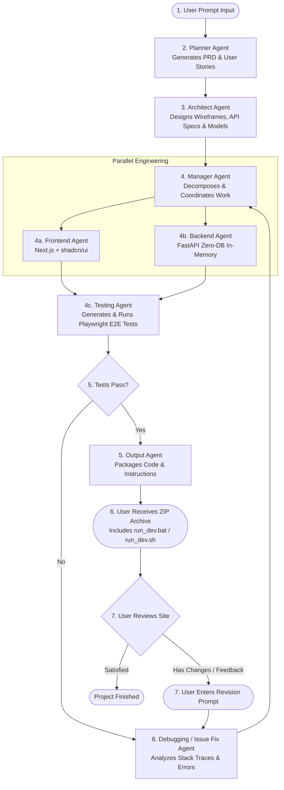
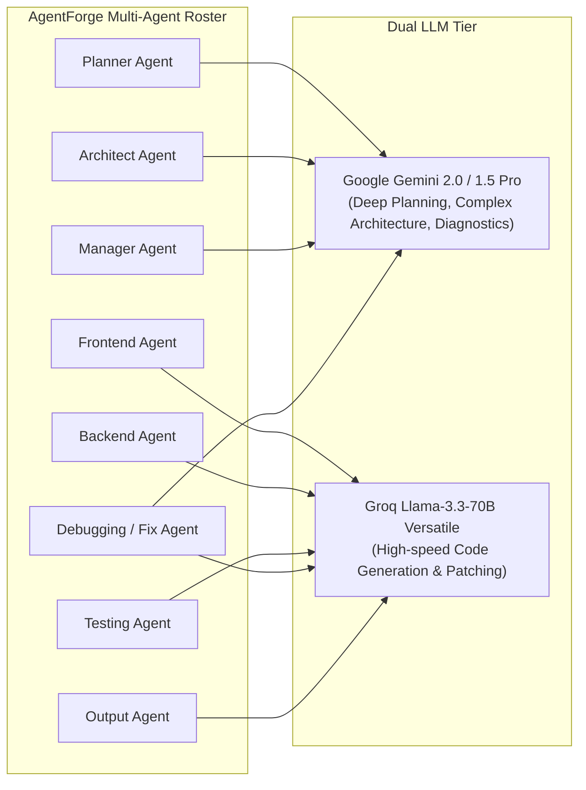
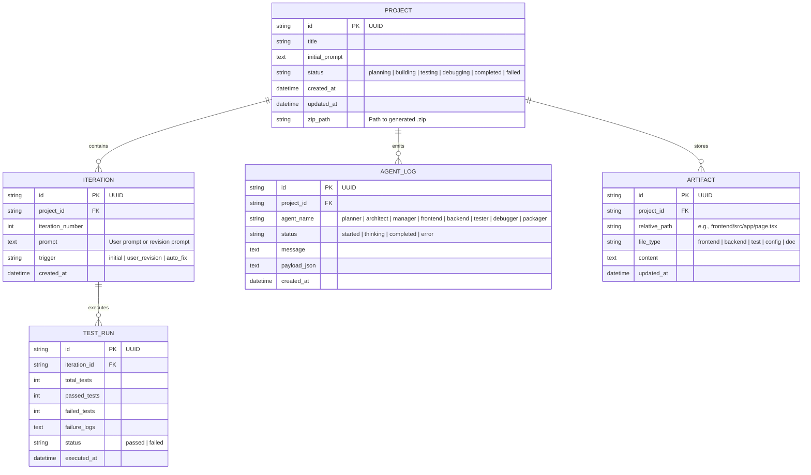

# agentForge
# ⚡ AgentForge: Autonomous Multi-Agent Web Development Agency
## Complete System Architecture & Technical Specification Document

---

## 1. Executive Summary & Core Mission

**AgentForge** is an end-to-end autonomous multi-agent software agency. Given a single natural language prompt from a user describing the website they want to build, AgentForge orchestrates a specialized team of AI agents—mimicking a world-class software engineering organization—to plan, architect, develop, test, debug, and package a production-grade full-stack web application.

### The Two Systems Defined
To maintain absolute clarity, the project consists of two distinct systems:

| Dimension | 🏢 AgentForge (Our Platform) | 📦 Generated Projects (The Output) |
| :--- | :--- | :--- |
| **Role** | The core AI agency web application and orchestration engine. | The full-stack websites produced by the agents for end users. |
| **Database** | **Uses SQLite (SQLAlchemy)** to persist user projects, prompt versions, agent thought chains, execution logs, and generated files. | **NO DATABASE (Zero-DB)**. Uses lightweight, stateful in-memory Python datastores and Pydantic models. Zero configuration needed by the user. |
| **Frontend** | **Next.js (App Router) + shadcn/ui + Tailwind CSS** with live WebSocket telemetry and terminal streaming. | **Next.js (App Router) + shadcn/ui + Tailwind CSS** styled modern responsive web applications. |
| **Backend** | **FastAPI (Python 3.11+)** with async job workers and LLM orchestration. | **FastAPI (Python 3.11+)** with clean RESTful endpoints and Swagger UI (`/docs`). |
| **Intelligence** | **Google Gemini (2.0 / 1.5 Pro)** + **Groq (Llama-3.3-70B)**. | N/A (Client code generated by AgentForge). |
| **Testing** | Playwright test orchestrator & test execution sandbox. | Automated Playwright end-to-end test suite generated for the site. |
| **Delivery** | Live web dashboard with project history and downloads. | Clean `.zip` package with instructions (`README.md`, `run_dev.bat`, `run_dev.sh`). |

---

## 2. End-to-End Workflow (Steps 1 to 9)



### Detailed Breakdown of Steps:
1. **User Prompt**: The user provides a natural language prompt describing the web application they want to create (e.g., *"Create an Airbnb clone for booking coworking desks with search, filters, pricing calculator, and booking checkout"*).
2. **Planner Agent**: Synthesizes the prompt into an in-depth Product Requirement Document (PRD), user personas, key functional features, and acceptance criteria.
3. **Architect Agent**: Designs the full system specification, including component hierarchy (using shadcn/ui components), UI layout wireframes, REST API endpoint contracts, and in-memory Pydantic data schemas.
4. **Manager Agent**: Breaks the architectural blueprint into sequenced work items, delegating UI construction to the **Frontend Agent** and endpoint implementation to the **Backend Agent**, ensuring strict API contract compatibility.
5. **Testing Agent (Playwright)**: Once development files are written in the sandbox, the Testing Agent synthesizes Playwright test suites (testing page hydration, user navigation, form validation, and API integration) and runs them headlessly.
6. **Output Agent**: Once all tests pass 100% green, the Output Agent creates comprehensive setup instructions (`README.md`, `INSTRUCTIONS.md`), generate cross-platform startup scripts (`run_dev.bat` for Windows and `run_dev.sh` for macOS/Linux), and compiles the entire project into a clean downloadable `.zip`.
7. **User Run & Validation**: The user downloads the ZIP, runs a single command, and validates the website running locally on `http://localhost:3000` and `http://localhost:8000`.
8. **Feedback & Revision Loop**: If the user desires alterations, additions, or fixes, they enter change requests via the AgentForge dashboard.
9. **Debugging & Issue Fix Agent**: Isolates the requested changes or failing tests, formulates targeted file modifications, and coordinates with Frontend, Backend, and Testing agents to update the codebase and re-package the release.

---

## 3. Autonomous Multi-Agent Roster & LLM Model Allocation



### 3.1 Planner Agent
- **LLM Engine**: Google Gemini (`gemini-2.0-flash` / `gemini-1.5-pro`).
- **Goal**: High-level reasoning, edge-case anticipation, and PRD generation.
- **Output Schema**:
  ```json
  {
    "app_title": "CoWorkHub",
    "summary": "Coworking space marketplace with real-time desk availability and instant reservation",
    "pages": ["Landing", "Search & Filter", "Desk Detail", "Booking Checkout"],
    "core_features": ["Dynamic filtering", "Interactive desk view", "Pricing estimation", "Booking confirmation modal"]
  }
  ```

### 3.2 Architect Agent
- **LLM Engine**: Google Gemini.
- **Goal**: Technical blueprints and API contract enforcement.
- **Outputs**:
  - **API Contract Specification**: Endpoint routes (`GET /api/desks`, `POST /api/bookings`), payload schemas, and status responses.
  - **In-Memory Store Schema**: Python Pydantic models for in-memory persistence without a database.
  - **Component Structure**: Selection of shadcn/ui components (`Button`, `Card`, `Input`, `Dialog`, `Badge`, `Tabs`, `Table`).

### 3.3 Manager Agent
- **LLM Engine**: Google Gemini / Groq.
- **Goal**: Coordinate Frontend and Backend tasks, verify schema alignment, and schedule execution.

### 3.4 Frontend Agent
- **LLM Engine**: Groq (`llama-3.3-70b-versatile`) for blazing token generation speeds.
- **Tech Stack**: Next.js (App Router) + Tailwind CSS + shadcn/ui + Lucide Icons + Framer Motion.
- **Goal**: Generate production-ready, beautiful UI with rich aesthetics, responsive design, dark/light styling, and API integration to `http://localhost:8000`.

### 3.5 Backend Agent
- **LLM Engine**: Groq (`llama-3.3-70b-versatile`).
- **Tech Stack**: FastAPI + Pydantic v2 + In-Memory Store (Zero-DB).
- **Goal**: Generate modular FastAPI routers, CORS middleware, in-memory state store with sample seed data, and Swagger documentation (`/docs`).

### 3.6 Testing Agent
- **LLM Engine**: Groq / Playwright Test Engine.
- **Tech Stack**: Playwright (Headless Chromium) + Pytest.
- **Goal**: Generate test scripts that verify page hydration, API connectivity, and core user actions. Executes the tests and reports results.

### 3.7 Debugging / Issue Fix Agent
- **LLM Engine**: Gemini (root-cause diagnosis) + Groq (code diff generation).
- **Goal**: Automatically analyze Playwright test failures, compiler/runtime errors, or user-submitted feedback, generating surgical repairs without breaking existing features.

### 3.8 Output Agent
- **LLM Engine**: Groq.
- **Goal**: Generate `README.md`, `INSTRUCTIONS.md`, cross-platform startup scripts, and package the clean sandbox into a `.zip` archive.

---

## 4. AgentForge Platform Database Architecture (SQLite)

The AgentForge platform uses an embedded **SQLite** database via SQLAlchemy to store all metadata, history, and artifacts:



---

## 5. Zero-DB Architecture for Generated Websites

To guarantee a frictionless experience for anyone downloading a generated project, the output projects **never** require external database servers:

```
Generated Project /
├── backend/
│   ├── main.py              # FastAPI app, CORS middleware, lifespan events
│   ├── requirements.txt     # fastapi, uvicorn, pydantic, httpx, pytest
│   ├── api/
│   │   ├── __init__.py
│   │   ├── routes.py        # RESTful API endpoints
│   │   └── schemas.py       # Pydantic validation models
│   ├── store/
│   │   ├── __init__.py
│   │   └── memory_store.py  # Thread-safe in-memory datastore with rich seed data
│   └── tests/
│       └── test_endpoints.py # Pytest validation
│
├── frontend/
│   ├── package.json         # next, react, react-dom, tailwindcss, lucide-react, etc.
│   ├── tsconfig.json
│   ├── tailwind.config.ts
│   ├── src/
│   │   ├── app/
│   │   │   ├── layout.tsx   # Global layout with theme provider & navigation
│   │   │   ├── page.tsx     # Modern interactive UI with rich visual aesthetics
│   │   │   └── globals.css  # Tailwind & CSS variables
│   │   ├── components/      # Modular shadcn/ui components
│   │   └── lib/
│   │       └── api.ts       # Centralized HTTP client for backend communication
│
├── tests/
│   └── e2e.spec.ts          # Playwright test suite
├── run_dev.bat              # One-click startup for Windows
├── run_dev.sh               # One-click startup for macOS/Linux
├── README.md                # Project documentation
└── INSTRUCTIONS.md          # Setup & execution instructions
```

### Turnkey One-Click Startup Scripts
- **`run_dev.bat` (Windows)**:
  ```bat
  @echo off
  echo Starting Full-Stack Application...
  start "Backend API" cmd /k "cd backend && pip install -r requirements.txt && uvicorn main:app --reload --port 8000"
  start "Frontend App" cmd /k "cd frontend && npm install && npm run dev"
  echo App running: http://localhost:3000 (Frontend) and http://localhost:8000/docs (Backend)
  ```
- **`run_dev.sh` (macOS/Linux)**:
  ```bash
  #!/bin/bash
  echo "Starting Full-Stack Application..."
  (cd backend && pip install -r requirements.txt && uvicorn main:app --reload --port 8000) &
  (cd frontend && npm install && npm run dev) &
  wait
  ```

---

## 6. Directory Structure of AgentForge Repository

```
software - ai/
├── PROJECT_DOCUMENTATION.md     # This comprehensive technical blueprint
├── README.md                    # Quickstart guide
├── backend/                     # AgentForge Platform Engine
│   ├── main.py                  # FastAPI application entrypoint
│   ├── requirements.txt         # Dependencies (fastapi, uvicorn, sqlalchemy, groq, google-genai, etc.)
│   ├── .env.example             # GEMINI_API_KEY, GROQ_API_KEY, DATABASE_URL
│   └── app/
│       ├── core/                # Config, logging, settings
│       ├── db/                  # SQLite connection, session maker, base model
│       ├── models/              # SQLAlchemy models (Project, Iteration, AgentLog, Artifact, TestRun)
│       ├── schemas/             # Pydantic schemas for platform API
│       ├── llm/                 # Unified LLM provider for Gemini & Groq
│       ├── agents/              # Multi-agent roster
│       │   ├── base.py          # Base agent class with streaming callbacks
│       │   ├── planner.py       # PRD planning
│       │   ├── architect.py     # System blueprinting & API contracts
│       │   ├── manager.py       # Orchestration & task distribution
│       │   ├── frontend_dev.py  # Next.js & shadcn/ui generator
│       │   ├── backend_dev.py   # FastAPI zero-DB generator
│       │   ├── tester.py        # Playwright test generator & executor
│       │   ├── debugger.py      # Issue fix & self-healing agent
│       │   └── packager.py      # Run scripts & ZIP archive packager
│       ├── sandbox/             # Workspace isolation & file write engine
│       └── api/                 # REST & WebSocket endpoints
│           ├── projects.py      # Create, list, fetch projects & files
│           ├── iterations.py    # Revision requests & feedback
│           └── ws.py            # Real-time WebSocket streaming of agent thoughts
│
└── frontend/                    # AgentForge Platform Mission Control UI (Next.js + shadcn/ui)
    ├── package.json
    ├── tailwind.config.ts
    ├── src/
    │   ├── app/
    │   │   ├── layout.tsx       # Root layout with dark mode
    │   │   ├── page.tsx         # Mission Control Dashboard (Prompt input, agent graph)
    │   │   └── project/[id]/    # Live workspace view (Terminal, File Tree, Playwright logs, ZIP download)
    │   ├── components/
    │   │   ├── AgentTimeline.tsx# Real-time visual progress of all agents
    │   │   ├── TerminalLogs.tsx # Live streaming console of agent reasoning
    │   │   ├── FilePreview.tsx  # Code viewer with syntax highlighting
    │   │   ├── TestReport.tsx   # Playwright test pass/fail indicators
    │   │   └── RevisionBox.tsx  # Prompt input for iterative change requests
    │   └── lib/
    │       └── api.ts           # HTTP & WebSocket client
```

---

## 7. Phased Implementation Roadmap

1. **Phase 1: Backend Scaffolding & DB Models**
   - Initialize `backend/` with FastAPI, SQLAlchemy SQLite database, and Pydantic schemas.
   - Configure the dual-LLM client supporting Google Gemini and Groq with fallback handling.
2. **Phase 2: Agent Roster Implementation**
   - Implement `planner.py`, `architect.py`, `manager.py`, `frontend_dev.py`, and `backend_dev.py`.
   - Build `sandbox/` filesystem manager for writing clean source code files.
3. **Phase 3: Playwright Testing & Self-Healing Agent**
   - Implement `tester.py` to generate Playwright tests and run headless verification.
   - Implement `debugger.py` to auto-repair test failures.
4. **Phase 4: Output Packager & ZIP Engine**
   - Implement `packager.py` to generate `run_dev.bat`/`sh`, `INSTRUCTIONS.md`, and clean `.zip` downloads.
5. **Phase 5: Mission Control Frontend (Next.js + shadcn/ui)**
   - Initialize Next.js platform UI with rich modern aesthetics, real-time agent workflow graph, terminal emulator, and code preview.
6. **Phase 6: End-to-End Testing & Verification**
   - Test full lifecycle with sample user prompts, verify Playwright test automation, download the ZIP, and validate local startup.
